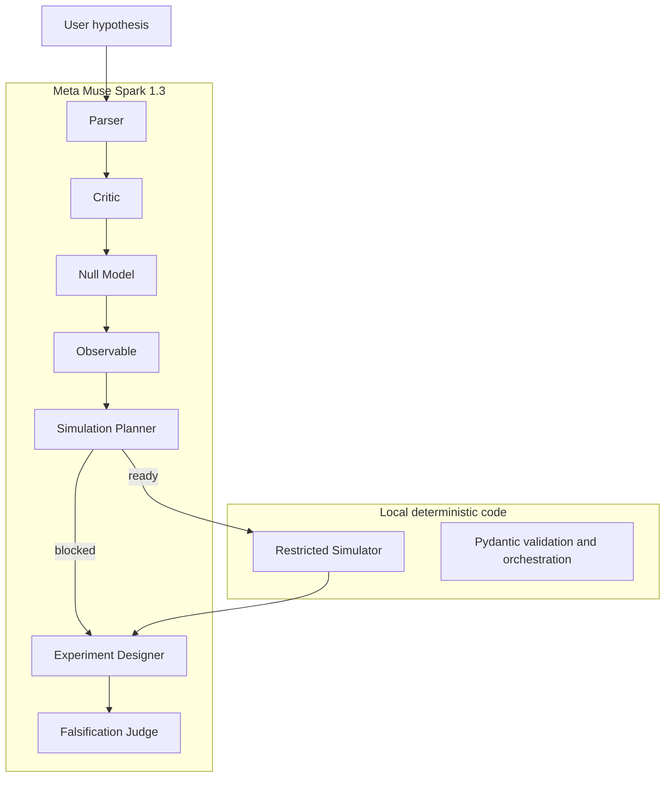
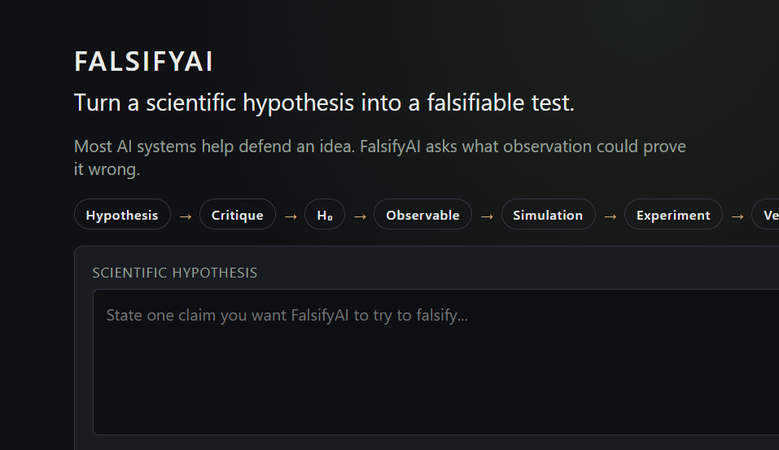
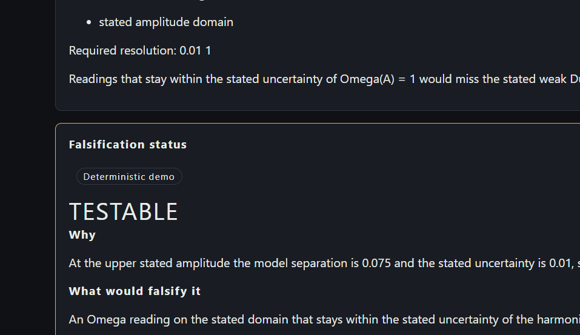
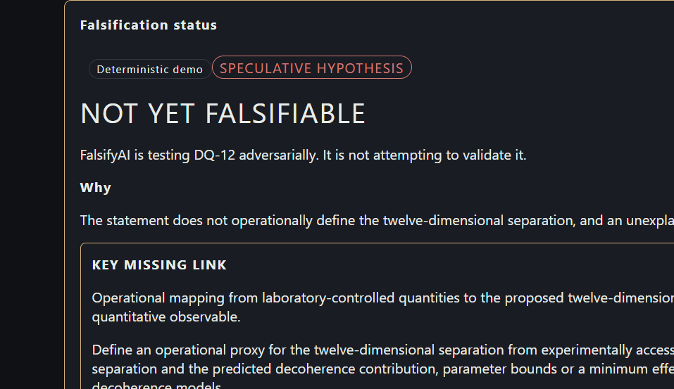
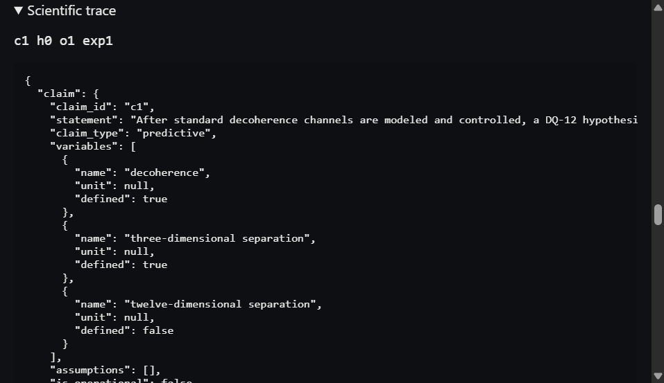

# FalsifyAI

FalsifyAI turns scientific hypotheses into adversarial falsification workflows.

Generative AI is good at making an idea sound plausible. Science advances by exposing an idea to a test it can fail. Structured Meta-model agents build the claim, the null model H₀, an observable, a simulation when a law is actually stated, an experiment, and one falsification status. The system is allowed to stop and say `NOT_YET_FALSIFIABLE`.

## The problem

A fluent model can defend almost any sentence. A judge still needs to see whether the sentence names a measurement, a competing explanation, and a finite way to fail.

## The idea

FalsifyAI does not argue for the user's hypothesis. It asks what observation could prove the hypothesis wrong, and it refuses to invent the missing science.

## 30-second example

Select **DUFFING CONTROL**. The hypothesis already states `Omega(A) = 1`, `Omega(A) = 1 + 0.075 * A^2`, the domain `0 <= A <= 1`, and uncertainty `0.01`. The run compares the curves and can return `TESTABLE`.

Select the **DQ-12** stress test. The same pipeline finds no operational map from laboratory quantities to a twelve-dimensional separation, blocks the simulation, and can return `NOT_YET_FALSIFIABLE`.

## Scientific pipeline

Hypothesis → Critique → H₀ → Observable → Simulation → Experiment → Verdict

Each stage constrains the next one. No observable, no claim of testability. No null model, no discrimination. No quantitative law, no invented simulation. No arbitrary model-generated code.

## Live benchmarks

### Duffing quantitative control

A synthetic dimensionless oscillator. H₀ is the harmonic frequency. H₁ is the weak Duffing shift supplied in the text. The chart is a model prediction, not experimental data. On the validated stub and the M6 live canary this case reached `TESTABLE`, with a maximum separation of 0.075 against a stated uncertainty of 0.01.

### DQ-12 speculative stress test

One public toy statement. FalsifyAI tries to falsify it. Ordinary decoherence and apparatus effects are the null. The twelve-dimensional separation is not replaced by ordinary distance. An unexplained residual is not evidence. The conservative result is `NOT_YET_FALSIFIABLE`.

## Architecture



Muse Spark 1.3 does the structured scientific reasoning. Local code validates every payload, runs the registered simulator, orchestrates the single run, and renders the screen.

## Meta model integration

Live stages call **Muse Spark 1.3** through the Meta Model API. The model id is fixed on the server. The client cannot choose it.

| Profile | Parser | Critic | Later reasoning stages |
|---|---|---|---|
| economy | minimal | low | low |
| balanced | minimal | low | medium |

Responses are strict JSON. Pydantic accepts the payload or the stage fails. Live mode does not fall back to the stub. The key is `MODEL_API_KEY` on the server only. It is not a `VITE_` variable and it is not in the image.

## Safety and scientific guardrails

- No verdict without a measurable observable.
- No discrimination without a null model.
- No invented measurements, sources, or coefficients.
- Simulations use a closed registry: constant, linear, quadratic, exponential decay.
- The public demo bounds hypothesis length and request size, allows only the economy and balanced profiles, and caps live runs per client in memory.
- `LIVE_RUNS_ENABLED=false` refuses live calls and leaves stub examples working.
- No database, authentication, file upload, external search, or arbitrary URL from the client.

## Local setup

Development is two processes. The API listens on port 8010 because another service may already own 8000. Vite does not proxy it.

```powershell
python -m venv .venv
.\.venv\Scripts\Activate.ps1
python -m pip install -e ".[dev]"
python -m pytest
uvicorn app.main:app --app-dir backend --env-file .env --reload --port 8010
```

From `frontend/`:

```powershell
npm install
npm run dev
```

`frontend/.env.development` sets `VITE_API_BASE_URL=http://127.0.0.1:8010` for that dev server only.

Copy `.env.example` to `.env` for live calls. Required server variables:

```text
MODEL_API_KEY=
META_BASE_URL=https://api.meta.ai/v1
META_MODEL_ID=muse-spark-1.3
```

Optional demo limits: `LIVE_RUNS_ENABLED`, `MAX_HYPOTHESIS_LENGTH` (1–4000), `MAX_REQUEST_BYTES`, `LIVE_RUN_LIMIT`, `LIVE_RUN_WINDOW_SECONDS`.

## Docker deployment

One image, one origin, one server-side secret.

```powershell
docker build -t falsifyai:m7 .
docker run --rm -p 8000:8000 ^
  -e PORT=8000 ^
  -e MODEL_API_KEY ^
  -e META_BASE_URL=https://api.meta.ai/v1 ^
  -e META_MODEL_ID=muse-spark-1.3 ^
  -e LIVE_RUNS_ENABLED=true ^
  falsifyai:m7
```

Pass the key from the environment. Do not bake `.env` into the image. The container command is `uvicorn app.main:app --app-dir backend --host 0.0.0.0 --port ${PORT:-8000}`.

Open `/` for the screen and `/health` for the process check. `/api/*` stays on the API. Refreshing the screen does not 404.

## API

The judge-facing call is `POST /api/v1/run`. Stub is the default. `mode` is `stub` or `live`. `reasoning_profile` is `economy` or `balanced`.

```json
{
  "hypothesis": {
    "statement": "Synthetic Duffing benchmark — model prediction, not experimental data. Dimensionless weakly nonlinear control on 0 <= A <= 1. H0 harmonic oscillator: Omega(A) = 1. H1 weak Duffing approximation: Omega(A) = 1 + 0.075 * A^2. Explicit benchmark measurement uncertainty sigma_Omega = 0.01 for Omega."
  },
  "mode": "stub",
  "reasoning_profile": "economy"
}
```

An abbreviated completed body:

```json
{
  "status": "completed",
  "verdict": { "status": "TESTABLE", "delta_over_sigma": 7.5 },
  "simulation_result": { "simulation_id": "sim1" },
  "experiment": { "status": "ready" }
}
```

`GET /api/v1/examples` returns the demo cards. `GET /health` returns `status`, `service`, and `milestone` only. Interactive reference: `/docs`.

## Tests

The M7 backend suite is **155** tests. The normal pytest run does not call the network. The frontend presentation suite and the TypeScript production build are separate. Live Muse Spark checks are manual scripts such as `python scripts/live_m6_smoke.py duffing`, and they are not part of pytest.

## Limitations

The in-memory live-run cap is a demo control. It is not an account system, and a new client address can start a new window. There is no database, login, PDF ingestion, or external search. The simulator cannot accept a new equation family from the model. DQ-12 is only the public toy sentence shipped in the demo.

## Hackathon provenance

This repository was created during the Meta Global AI Developer Hackathon 2026. See [docs/HACKATHON_PROVENANCE.md](docs/HACKATHON_PROVENANCE.md) and [docs/RELEASE_M7.md](docs/RELEASE_M7.md).

## Authors / acknowledgements

Juan José Espinosa, Independent Researcher / TallerTecno.

Collaborative AI assistance helped implement and review the software. That assistance is not a human team member and is not an entrant.

The spoken demo is [docs/DEMO_SCRIPT_3MIN.md](docs/DEMO_SCRIPT_3MIN.md). Form copy is [docs/SUBMISSION_COPY.md](docs/SUBMISSION_COPY.md).

## Screenshots

Captured from the local production screen. The runs below are labeled deterministic demo.








